# Call_Graph_Diagram

> Auto-generated by Claude Workflow Engine | Last updated: 2026-10-25

```mermaid
flowchart LR
    subgraph AuditContainer_group[AuditContainer]
        code_container_py__AuditContainer___init__["__init__(dataset_dir)"]
        code_container_py__AuditContainer_initialize_identities["initialize_identities()"]
    end
    subgraph DeletionAuditOrchestrator_group[DeletionAuditOrchestrator]
        code_main_py__DeletionAuditOrchestrator___init__["__init__(container)"]
        code_main_py__DeletionAuditOrchestrator_audit_single_request["audit_single_request(req)"]
        code_main_py__DeletionAuditOrchestrator_run_pipeline["run_pipeline(requests_csv, output_csv)"]
    end
    subgraph standalone_group[Functions]
        code_main_py__main["main()"]
        code___init___py___load_stdlib_code["_load_stdlib_code()"]
        code___init___py____getattr__["__getattr__(name)"]
        tests_test_ai_agent_security_py__test_input_sanitizer_zero_width_character_stripping["test_input_sanitizer_zero_width_character_stripping()"]
        tests_test_ai_agent_security_py__test_input_sanitizer_prompt_injection_detection["test_input_sanitizer_prompt_injection_detection()"]
        tests_test_ai_agent_security_py__test_pii_shield_credit_card_luhn_masking["test_pii_shield_credit_card_luhn_masking()"]
        tests_test_ai_agent_security_py__test_pii_shield_ssn_and_phone_masking["test_pii_shield_ssn_and_phone_masking()"]
        tests_test_ai_agent_security_py__test_token_bucket_rate_limiter_burst_and_refill["test_token_bucket_rate_limiter_burst_and_refill()"]
        tests_test_ai_agent_security_py__test_circuit_breaker_trip_and_recovery["test_circuit_breaker_trip_and_recovery()"]
        tests_test_ai_agent_security_py__test_threat_detector_entropy_and_scoring["test_threat_detector_entropy_and_scoring()"]
        tests_test_ai_token_and_context_optimization_py__test_pos_01_token_estimation_accuracy["test_pos_01_token_estimation_accuracy()"]
        tests_test_ai_token_and_context_optimization_py__test_pos_02_semantic_deduplication_ratio["test_pos_02_semantic_deduplication_ratio()"]
        tests_test_ai_token_and_context_optimization_py__test_pos_03_dense_serialization_compression["test_pos_03_dense_serialization_compression()"]
        tests_test_ai_token_and_context_optimization_py__test_pos_04_causal_cone_temporal_admissibility["test_pos_04_causal_cone_temporal_admissibility()"]
        tests_test_ai_token_and_context_optimization_py__test_pos_05_valid_witness_grounding_pass["test_pos_05_valid_witness_grounding_pass()"]
        tests_test_ai_token_and_context_optimization_py__test_pos_06_knapsack_context_budget_fit["test_pos_06_knapsack_context_budget_fit()"]
        tests_test_ai_token_and_context_optimization_py__test_neg_01_hallucinated_evidence_id_rejection["test_neg_01_hallucinated_evidence_id_rejection()"]
        tests_test_ai_token_and_context_optimization_py__test_neg_02_post_audit_evidence_rejection["test_neg_02_post_audit_evidence_rejection()"]
        tests_test_ai_token_and_context_optimization_py__test_neg_03_decoy_unrelated_fact_suppression["test_neg_03_decoy_unrelated_fact_suppression()"]
        tests_test_ai_token_and_context_optimization_py__test_neg_04_invalid_operation_rejection["test_neg_04_invalid_operation_rejection()"]
        tests_test_ai_token_and_context_optimization_py__test_neg_05_remediation_non_empty_evidence_id_sanitization["test_neg_05_remediation_non_empty_evidence_id_sanitization()"]
        tests_test_ai_token_and_context_optimization_py__test_neg_06_token_budget_overflow_shedding["test_neg_06_token_budget_overflow_shedding()"]
        tests_test_ai_token_and_context_optimization_py__test_edge_01_empty_facts_context_handling["test_edge_01_empty_facts_context_handling()"]
        tests_test_ai_token_and_context_optimization_py__test_edge_02_multilingual_unicode_token_estimation["test_edge_02_multilingual_unicode_token_estimation()"]
        tests_test_ai_token_and_context_optimization_py__test_edge_03_zero_width_adversarial_token_smuggling["test_edge_03_zero_width_adversarial_token_smuggling()"]
        tests_test_ai_token_and_context_optimization_py__test_edge_04_circular_trace_id_deduplication["test_edge_04_circular_trace_id_deduplication()"]
        tests_test_ai_token_and_context_optimization_py__test_edge_05_mixed_not_applicable_steps_json_empty["test_edge_05_mixed_not_applicable_steps_json_empty()"]
        tests_test_ai_token_and_context_optimization_py__test_edge_06_tombstone_redacted_witness_validation["test_edge_06_tombstone_redacted_witness_validation()"]
        tests_test_ai_token_and_context_optimization_py__test_pos_07_prompt_tokens_estimation_reconciliation["test_pos_07_prompt_tokens_estimation_reconciliation()"]
        tests_test_ai_token_and_context_optimization_py__test_pos_08_calculate_serialization_savings["test_pos_08_calculate_serialization_savings()"]
        tests_test_ai_token_and_context_optimization_py__test_neg_07_empty_payloads_graceful_handling["test_neg_07_empty_payloads_graceful_handling()"]
        tests_test_ai_token_and_context_optimization_py__test_edge_07_multithreaded_token_optimizer_concurrency["test_edge_07_multithreaded_token_optimizer_concurrency()"]
        tests_test_concurrency_and_performance_py__test_concurrent_orchestrator_multi_worker_execution["test_concurrent_orchestrator_multi_worker_execution(tmp_path)"]
        tests_test_concurrency_and_performance_py__test_concurrent_rate_limiter_thread_safety["test_concurrent_rate_limiter_thread_safety()"]
        tests_test_concurrency_and_performance_py__test_concurrent_output_natural_numeric_sorting["test_concurrent_output_natural_numeric_sorting(tmp_path)"]
    end
    code_container_py__AuditContainer___init__ --> code_container_py__AuditContainer_initialize_identities
    code_main_py__DeletionAuditOrchestrator___init__ --> code_container_py__AuditContainer___init__
    code_main_py__DeletionAuditOrchestrator_run_pipeline --> code_main_py__DeletionAuditOrchestrator_audit_single_request
    code_main_py__main --> code_container_py__AuditContainer___init__
    code_main_py__main --> code_main_py__DeletionAuditOrchestrator___init__
    code_main_py__main --> code_main_py__DeletionAuditOrchestrator_run_pipeline
    code___init___py____getattr__ --> code___init___py___load_stdlib_code
    tests_test_concurrency_and_performance_py__test_concurrent_orchestrator_multi_worker_execution --> code_container_py__AuditContainer___init__
    tests_test_concurrency_and_performance_py__test_concurrent_output_natural_numeric_sorting --> code_container_py__AuditContainer___init__
    style code_main_py__DeletionAuditOrchestrator_audit_single_request fill:#ff6666
    style code_main_py__DeletionAuditOrchestrator_run_pipeline fill:#ff6666
    style code_main_py__main stroke-width:3px,fill:#ff6666
    style code___init___py___load_stdlib_code fill:#ff6666
    style tests_test_ai_agent_security_py__test_input_sanitizer_zero_width_character_stripping stroke-width:3px
    style tests_test_ai_agent_security_py__test_input_sanitizer_prompt_injection_detection stroke-width:3px
    style tests_test_ai_agent_security_py__test_pii_shield_credit_card_luhn_masking stroke-width:3px,fill:#ff6666
    style tests_test_ai_agent_security_py__test_pii_shield_ssn_and_phone_masking stroke-width:3px
    style tests_test_ai_agent_security_py__test_token_bucket_rate_limiter_burst_and_refill stroke-width:3px,fill:#ff6666
    style tests_test_ai_agent_security_py__test_circuit_breaker_trip_and_recovery stroke-width:3px,fill:#ff6666
    style tests_test_ai_agent_security_py__test_threat_detector_entropy_and_scoring stroke-width:3px
    style tests_test_ai_token_and_context_optimization_py__test_pos_01_token_estimation_accuracy stroke-width:3px
    style tests_test_ai_token_and_context_optimization_py__test_pos_02_semantic_deduplication_ratio stroke-width:3px
    style tests_test_ai_token_and_context_optimization_py__test_pos_03_dense_serialization_compression stroke-width:3px
    style tests_test_ai_token_and_context_optimization_py__test_pos_04_causal_cone_temporal_admissibility stroke-width:3px
    style tests_test_ai_token_and_context_optimization_py__test_pos_05_valid_witness_grounding_pass stroke-width:3px
    style tests_test_ai_token_and_context_optimization_py__test_pos_06_knapsack_context_budget_fit stroke-width:3px
    style tests_test_ai_token_and_context_optimization_py__test_neg_01_hallucinated_evidence_id_rejection stroke-width:3px
    style tests_test_ai_token_and_context_optimization_py__test_neg_02_post_audit_evidence_rejection stroke-width:3px
    style tests_test_ai_token_and_context_optimization_py__test_neg_03_decoy_unrelated_fact_suppression stroke-width:3px
    style tests_test_ai_token_and_context_optimization_py__test_neg_04_invalid_operation_rejection stroke-width:3px
    style tests_test_ai_token_and_context_optimization_py__test_neg_05_remediation_non_empty_evidence_id_sanitization stroke-width:3px
    style tests_test_ai_token_and_context_optimization_py__test_neg_06_token_budget_overflow_shedding stroke-width:3px
    style tests_test_ai_token_and_context_optimization_py__test_edge_01_empty_facts_context_handling stroke-width:3px,fill:#ff6666
    style tests_test_ai_token_and_context_optimization_py__test_edge_02_multilingual_unicode_token_estimation stroke-width:3px
    style tests_test_ai_token_and_context_optimization_py__test_edge_03_zero_width_adversarial_token_smuggling stroke-width:3px
    style tests_test_ai_token_and_context_optimization_py__test_edge_04_circular_trace_id_deduplication stroke-width:3px
    style tests_test_ai_token_and_context_optimization_py__test_edge_05_mixed_not_applicable_steps_json_empty stroke-width:3px
    style tests_test_ai_token_and_context_optimization_py__test_edge_06_tombstone_redacted_witness_validation stroke-width:3px
    style tests_test_ai_token_and_context_optimization_py__test_pos_07_prompt_tokens_estimation_reconciliation stroke-width:3px
    style tests_test_ai_token_and_context_optimization_py__test_pos_08_calculate_serialization_savings stroke-width:3px
    style tests_test_ai_token_and_context_optimization_py__test_neg_07_empty_payloads_graceful_handling stroke-width:3px,fill:#ff6666
    style tests_test_ai_token_and_context_optimization_py__test_edge_07_multithreaded_token_optimizer_concurrency stroke-width:3px,fill:#ff6666
    style tests_test_concurrency_and_performance_py__test_concurrent_orchestrator_multi_worker_execution stroke-width:3px,fill:#ff6666
    style tests_test_concurrency_and_performance_py__test_concurrent_rate_limiter_thread_safety stroke-width:3px,fill:#ff6666
    style tests_test_concurrency_and_performance_py__test_concurrent_output_natural_numeric_sorting stroke-width:3px
```

## Notes

- Generated from: C:\Users\techd\Documents\workspace-spring-tool-suite-4-4.27.0-new\hackerrank_orchestration_problem
- Scope: Full project
