# UML Communication (Collaboration) Diagram: Autonomous Deletion Audit Agent
**Challenge:** HackerRank Orchestrate (October 2026) — *Ghost Data Still Exists*  
**System:** Enterprise Deletion Audit Agent & Compliance Verification Platform  
**Authors:** Visual Architecture & Design Squad (`uml-interaction-diagram-engineer`, `uml-diagram-mathematics-expert`)  
**Specification Standards:** Conforms to UML 2.5.1 Section 17.3 (Communication Diagrams) and Level 2.2 Docstrings-Only convention.

---

## 1. Multi-Agent Collaboration & Message Flows

This communication diagram models structural links between runtime collaborating roles and the sequence of numbered synchronous/asynchronous messages exchanged across the multi-agent graph.

```mermaid
flowchart TD
    %% ==========================================
    %% COLLABORATING LIFELINES / ROLES
    %% ==========================================
    CLI["1: Participant / CLI Runner"]
    ORCH["2: DeletionAuditOrchestrator<br/>(Master Pipeline)"]
    SAN["3: InputSanitizer<br/>(Security Guard)"]
    CONT["4: AuditContainer<br/>(IoC Assembly)"]
    POL["5: PolicyAuditor<br/>(NLU & Rules)"]
    RES["6: IdentityResolver<br/>(DSU Engine)"]
    INSP["7: MultimodalInspector<br/>(Evidence Scanner)"]
    LIN["8: LineageTracer<br/>(Activity Tracker)"]
    CTX["9: ContextBuilder<br/>(Knapsack Allocator)"]
    OPT["10: TokenOptimizer<br/>(BPE Deduplicator)"]
    PLAN["11: RemediationPlanner<br/>(Poset DAG Engine)"]
    GRD["12: PromptGuard<br/>(Witness Verifier)"]
    REP["13: ReplayTracer<br/>(LRU Registry)"]
    CSV["14: CsvHandler<br/>(RFC-4180 Egress)"]

    %% ==========================================
    %% MESSAGE EXCHANGES & COLLABORATION LINKS
    %% ==========================================
    CLI ---|"1.0: execute(dataset_dir)<br/>14.0: return exit_code(0)"| ORCH

    ORCH ---|"1.1: initialize()<br/>1.2: container_ready"| CONT

    ORCH ---|"2.0: sanitize(request_text)<br/>2.1: [clean_text, is_adv]"| SAN

    ORCH ---|"3.0: is_deletion_request(clean_text)<br/>3.1: [is_authorized]"| POL

    ORCH ---|"4.0: resolve_cluster(email)<br/>4.1: [identity_tokens]"| RES

    ORCH ---|"5.0: query_facts(tokens, audit_at)<br/>5.1: [candidate_facts]"| INSP

    ORCH ---|"6.0: trace_active_flows(tokens, rep_dt)<br/>6.1: [flows, restore_risks]"| LIN

    ORCH ---|"7.0: pack_context(facts, 4096)<br/>7.1: [knapsack_facts]"| CTX

    ORCH ---|"8.0: deduplicate_facts(knapsack_facts)<br/>8.1: [unique_facts, saved_tokens]"| OPT

    ORCH ---|"9.0: evaluate_retention_rules(facts)<br/>9.1: [findings, compliant_records]"| POL

    ORCH ---|"10.0: build_steps(verdict, findings, verifs)<br/>10.1: [ordered_steps_1..K]"| PLAN

    ORCH ---|"11.0: verify_witness_grounding(steps)<br/>11.1: [grounded_steps]"| GRD

    ORCH ---|"12.0: record_decision(cid, verdict, steps)<br/>12.1: ack"| REP

    ORCH ---|"13.0: stream_row(cid, verdict, steps_json)<br/>13.1: flush"| CSV

    %% Intra-Container Associations
    CONT ---|"1.1.1: load_identities_and_audit_log()"| RES
    CONT ---|"1.1.2: inspect_all_evidence()"| INSP
    CONT ---|"1.1.3: load_activities()"| LIN
    CONT ---|"1.1.4: load_rules_from_csv()"| POL
```

---

## 2. Message Dispatch Specification

| Sequence | Sender | Receiver | Message Signature | Guard Condition / Note |
|---|---|---|---|---|
| `1.0` | CLI | Orchestrator | `execute(dataset_dir, max_workers=8)` | Pipeline launch |
| `1.1` | Orchestrator | AuditContainer | `initialize()` | One-time lazy pre-index |
| `1.1.1` | AuditContainer | IdentityResolver | `load_identities_and_audit_log()` | Builds DSU & orbit cache |
| `1.1.2` | AuditContainer | MultimodalInspector | `inspect_all_evidence()` | Pre-indexes SQL & manifest |
| `1.1.3` | AuditContainer | LineageTracer | `load_activities()` | Pre-sorts worker timestamps |
| `1.1.4` | AuditContainer | PolicyAuditor | `load_rules_from_csv()` | Loads statutory mandates |
| `2.0` | Orchestrator | InputSanitizer | `sanitize(request_text)` | OWASP LLM01 defense |
| `3.0` | Orchestrator | PolicyAuditor | `is_deletion_request(text)` | Checks 30+ multilingual indicators |
| `4.0` | Orchestrator | IdentityResolver | `resolve_cluster(email)` | $O(\alpha(N))$ equivalence orbit |
| `5.0` | Orchestrator | MultimodalInspector | `query_facts(tokens, audit_at)` | Temporal filter $T(e) \le audit\_at$ |
| `6.0` | Orchestrator | LineageTracer | `trace_active_flows(tokens, rep_dt)` | Monotone bisect $O(\log K)$ |
| `7.0` | Orchestrator | ContextBuilder | `pack_context(facts, budget=4096)` | Priority knapsack allocation |
| `8.0` | Orchestrator | TokenOptimizer | `deduplicate_facts(facts)` | Saves 19,332 tokens |
| `9.0` | Orchestrator | PolicyAuditor | `evaluate_retention_rules(facts)` | Identifies statutory exceptions |
| `10.0` | Orchestrator | RemediationPlanner | `build_steps(verdict, findings, verifs)` | Poset injective 5-tuple sort |
| `11.0` | Orchestrator | PromptGuard | `verify_witness_grounding(steps)` | $P(\text{Hallucination}) = 0$ |
| `12.0` | Orchestrator | ReplayTracer | `record_decision(...)` | LRU 2000 cache update |
| `13.0` | Orchestrator | CsvHandler | `stream_row(cid, verdict, steps_json)` | RFC-4180 thread-safe write |
| `14.0` | Orchestrator | CLI | `return exit_code(0)` | 518 cases completed |
