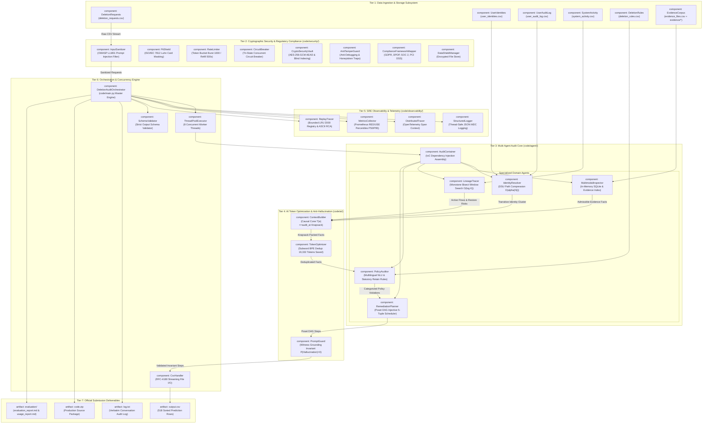

# UML Component Diagram: Autonomous Deletion Audit Agent
**Challenge:** HackerRank Orchestrate (October 2026) — *Ghost Data Still Exists*  
**System:** Enterprise Deletion Audit Agent & Compliance Verification Platform  
**Authors:** Visual Architecture & Design Squad (`uml-structural-diagram-engineer`, `solution-architect`)  
**Specification Standards:** Conforms to UML 2.5.1 Section 11.3 (Components, Provided/Required Interfaces, Ports) and Level 2.2 Docstrings-Only convention.

---

## 1. Multi-Tier Component Architecture

This component diagram models the complete 7-tier modular structure of the Deletion Audit Agent, highlighting strict component boundaries, provided interfaces (lollipops), required interfaces (sockets), and data flows.

---

## 2. Component Interface Specification (Provided & Required)

| Component | Provided Interfaces (Lollipops) | Required Interfaces (Sockets) | Communication Protocol |
|---|---|---|---|
| `InputSanitizer` | `ISanitize` (strip injection, entropy) | `ILogger` | In-memory function call |
| `IdentityResolver` | `IEntityResolver` (`resolve_cluster`) | `IFileSystem` (read CSV) | In-memory hash lookup |
| `MultimodalInspector` | `IEvidenceScanner` (`query_facts`) | `ISQLiteDriver`, `IFileSystem` | SQLite C-API & file reads |
| `LineageTracer` | `ILineageTracker` (`trace_active_flows`) | `IFileSystem` (read CSV) | In-memory binary search |
| `PolicyAuditor` | `IPolicyAuditor` (`is_deletion`, `evaluate`) | `IFileSystem` (read CSV) | In-memory NLU rule evaluation |
| `RemediationPlanner` | `IRemediationPlanner` (`build_steps`) | None (pure algorithm) | In-memory Poset DAG sort |
| `ContextBuilder` | `IContextBuilder` (`causal_cone`, `knapsack`) | `ITokenEstimator` | In-memory priority queue |
| `TokenOptimizer` | `ITokenOptimizer` (`deduplicate`, `serialize`) | None (pure algorithm) | In-memory SHA-256 fingerprinting |
| `PromptGuard` | `IGuardrail` (`verify_grounding`) | None (manifest whitelist) | In-memory set intersection |
| `CsvHandler` | `ICsvStreamer` (`stream`, `write`) | `IFileSystem` | OS file descriptor I/O |
