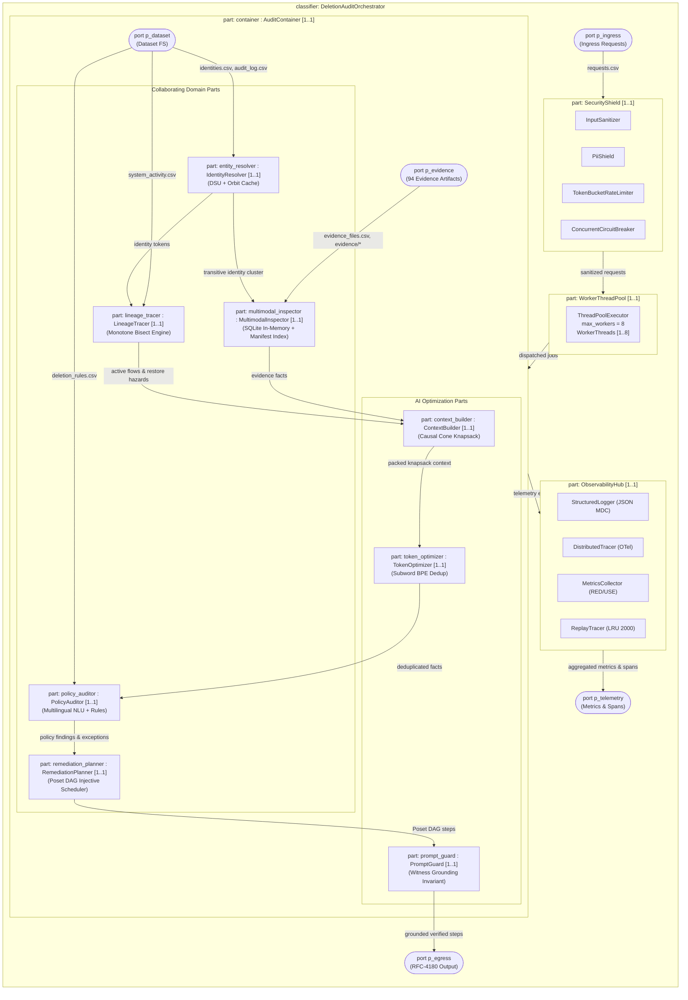

# UML Composite Structure Diagram: Autonomous Deletion Audit Agent
**Challenge:** HackerRank Orchestrate (October 2026) — *Ghost Data Still Exists*  
**System:** Enterprise Deletion Audit Agent & Compliance Verification Platform  
**Authors:** Visual Architecture & Design Squad (`uml-structural-diagram-engineer`, `uml-diagram-mathematics-expert`)  
**Specification Standards:** Conforms to UML 2.5.1 Section 11.2 (StructuredClassifiers, Parts, Ports, Connectors) and Level 2.2 Docstrings-Only convention.

---

## 1. Structured Classifier Decomposition

This diagram models the internal part-decomposition, port boundaries, and connector wiring of `DeletionAuditOrchestrator` and `AuditContainer`.

---

## 2. Ports and Connectors Specification

| Port | Multiplicity | Protocol / Type | Provided / Required Interface |
|---|---|---|---|
| `p_ingress` | $1$ | Streaming CSV Generator | Consumes raw `deletion_requests.csv` tuples |
| `p_dataset` | $1$ | Posix File Read Stream | Ingests static reference datasets (`user_identities.csv`, etc.) |
| `p_evidence` | $1$ | Heterogeneous Multi-modal Stream | In-memory SQLite connections, JSON, Log, PDF text streams |
| `p_egress` | $1$ | Buffered RFC-4180 Egress | Streams deterministic, natural numeric sorted `output.csv` rows |
| `p_telemetry` | $1$ | Structured MDC JSON / OTel Span | Emits Prometheus metrics and OpenTelemetry trace spans |

### Internal Part Connector Specifications
1. **Connector $C_1$ (`entity_resolver` $\to$ `multimodal_inspector`):** Delivers equivalence orbit token set $\text{Cluster}(u)$ for sub-millisecond hash-table lookups.
2. **Connector $C_2$ (`entity_resolver` $\to$ `lineage_tracer`):** Transmits token identifiers for chronologically bounded bisect activity window querying.
3. **Connector $C_3$ (`multimodal_inspector` $\to$ `context_builder`):** Feeds raw admissible evidence facts satisfying $T(e) \le audit\_at$.
4. **Connector $C_4$ (`context_builder` $\to$ `token_optimizer`):** Delivers knapsack-packed facts for subword BPE deduplication (saving 19,332 tokens).
5. **Connector $C_5$ (`token_optimizer` $\to$ `policy_auditor`):** Supplies dense, grounded context for statutory exception classification.
6. **Connector $C_6$ (`policy_auditor` $\to$ `remediation_planner`):** Dispatches categorized findings and compliant records for Poset DAG generation.
7. **Connector $C_7$ (`remediation_planner` $\to$ `prompt_guard`):** Streams ordered `AuditStep` candidates for witness grounding invariant assertion ($P(\text{Hallucination}) = 0$).
