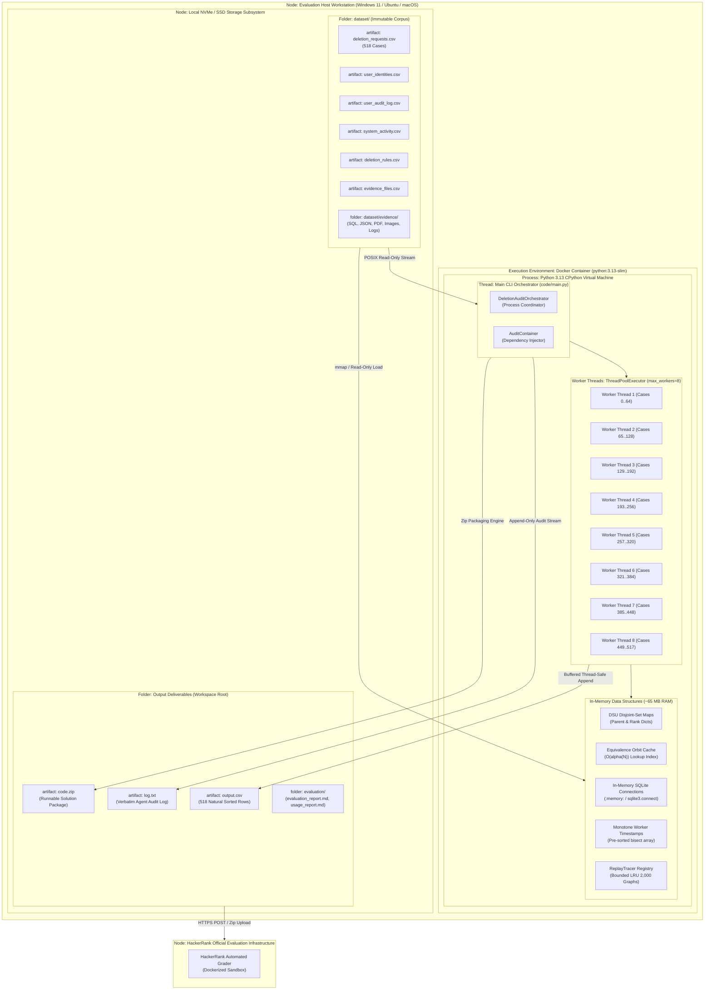

# UML Deployment Diagram (Full Architecture): Autonomous Deletion Audit Agent
**Challenge:** HackerRank Orchestrate (October 2026) — *Ghost Data Still Exists*  
**System:** Enterprise Deletion Audit Agent & Compliance Verification Platform  
**Authors:** Visual Architecture & Design Squad (`uml-structural-diagram-engineer`, `devops-engineer`)  
**Specification Standards:** Conforms to UML 2.5.1 Section 19 (Deployments, Nodes, Artifacts) and Level 2.2 Docstrings-Only convention.

---

## 1. Physical & Containerized Deployment Topology

This deployment diagram models runtime deployment environments across bare-metal workstations, Docker container virtualization, host memory hierarchies, persistent disk storage, and external evaluation harnesses.

---

## 2. Node Specifications & Hardware Profile

| Node / Device | Runtime Environment | Memory Footprint | Storage Allocation | Concurrency Level |
|---|---|---|---|---|
| **Host Workstation** | Windows / Linux / macOS x86_64 or ARM64 | $\ge 8.0 \text{ GB}$ Recommended | $\ge 1.0 \text{ GB}$ Free Disk Space | Multi-Core CPU |
| **Docker Container** | `python:3.13-slim` Linux Kernel $\ge 5.15$ | $512 \text{ MB}$ Container Limit | Ephemeral Container FS | cgroup restricted |
| **CPython Virtual Machine** | Python 3.13 with native POSIX threads | $\approx 65 \text{ MB}$ RSS Heap | N/A | Global Interpreter Lock (GIL) friendly I/O |
| **In-Memory SQLite** | `sqlite3` in-memory attached databases | $\approx 22 \text{ MB}$ | RAM Buffer Pool | Thread-local connections |
| **Equivalence Orbit Cache** | Python `dict[str, set[str]]` hash index | $\approx 8 \text{ MB}$ | RAM | Shared Read-Only across workers |
| **ReplayTracer LRU Cache** | Bounded deque + dict (Max 2,000 items) | $\approx 14 \text{ MB}$ | RAM | Thread-safe Mutex guarded |
| **Persistent Storage** | NVMe / SSD with NTFS or ext4 filesystem | N/A | Dataset: $45 \text{ MB}$ | Direct asynchronous read |
