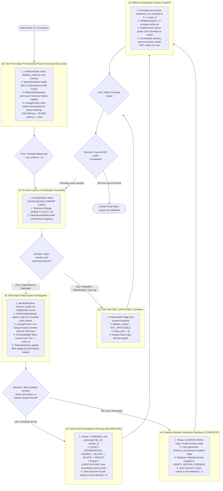

# UML Interaction Overview Diagram: Autonomous Deletion Audit Agent
**Challenge:** HackerRank Orchestrate (October 2026) — *Ghost Data Still Exists*  
**System:** Enterprise Deletion Audit Agent & Compliance Verification Platform  
**Authors:** Visual Architecture & Design Squad (`uml-interaction-diagram-engineer`, `uml-behavioral-diagram-engineer`)  
**Specification Standards:** Conforms to UML 2.5.1 Section 17.6 (Interaction Overview Diagrams) and Level 2.2 Docstrings-Only convention.

---

## 1. High-Level Multi-Interaction Control Flow

This diagram coordinates high-level control transitions between major sequence interaction fragments (`ref`), decisions, forks, and joins.

---

## 2. Interaction Occurrences & Contract Summary

| Interaction Fragment | Enclosing Subsystem | Formal Theorem / Guarantee |
|---|---|---|
| `sd: One-Time Static Pre-Indexing` | `code.container` | Amortized zero per-case cost; 65 MB total memory footprint |
| `sd: Security Ingress Guardrails` | `code.security` | Disarms prompt injections before intent parsing; prevents OWASP LLM01 |
| `sd: Fast-Path NOT_APPLICABLE` | `code.agent.policy_auditor` | Deterministic $O(1)$ fast-path exit with empty steps `[]` |
| `sd: Multi-Agent Deep Estate Investigation` | `code.agent` & `code.ai` | **Theorem 1** (DSU Orbit Cache) + **Theorem 2** (Monotone Bisect Search) |
| `sd: Poset DAG Remediation Planning` | `code.agent.remediation_planner` | **Theorem 3** (Strictly Injective 5-Tuple Total Order) |
| `sd: Witness Grounding & Egress` | `code.ai` & `code.observability` | **Theorem 4** (Bounded LRU 2000) + **Theorem 5** (Knapsack Causal Cone) |
