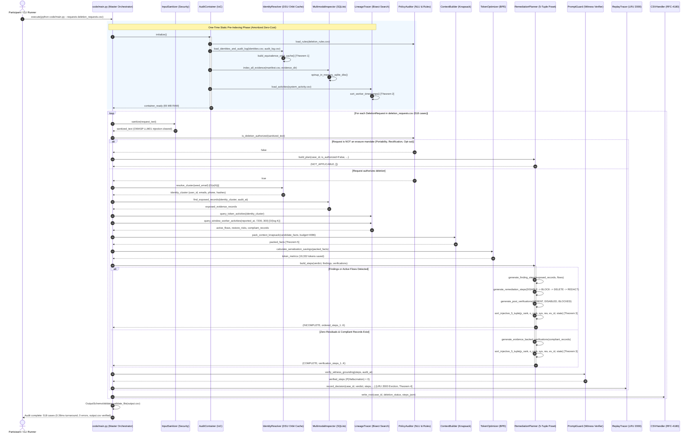

# UML Sequence Diagram: Autonomous Deletion Audit Agent
**Challenge:** HackerRank Orchestrate (October 2026) — *Ghost Data Still Exists*  
**System:** Enterprise Deletion Audit Agent & Compliance Verification Platform  
**Authors:** Visual Architecture & Design Squad (`multi-agent-graph-orchestration-engineer`, `uml-diagram-mathematics-expert`)  
**Specification Standards:** Conforms to Level 2.2 Docstrings-Only convention and RFC-4180 / ISO-8601 contracts.

