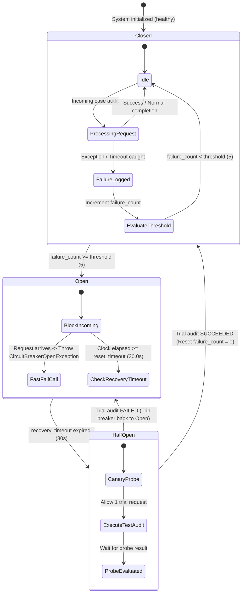

# UML State Machine Diagram: Autonomous Deletion Audit Agent
**Challenge:** HackerRank Orchestrate (October 2026) — *Ghost Data Still Exists*  
**System:** Enterprise Deletion Audit Agent & Compliance Verification Platform  
**Authors:** Visual Architecture & Design Squad (`uml-behavioral-diagram-engineer`, `uml-diagram-mathematics-expert`)  
**Specification Standards:** Conforms to UML 2.5.1 Section 14 (State Machines) and Level 2.2 Docstrings-Only convention.

---

## 1. Deletion Case Lifecycle State Machine

This state machine models the complete lifecycle of an individual deletion audit request (`case_id`) from initial ingestion to final output CSV emission. It models all decision gates, error recovery paths, and verdict terminations.

```mermaid
stateDiagram-v2
    [*] --> Ingested : DeletionRequest row parsed

    state Ingested {
        [*] --> ValidatingSchema
        ValidatingSchema --> SanitizingInput : RFC-4180 format OK
        SanitizingInput --> CheckingInjection : Shannon entropy H in [2.5, 5.0]
        CheckingInjection --> IngressReady : P(Injection) == 0
        CheckingInjection --> AdversarialNeutralized : Adversarial pattern detected
        AdversarialNeutralized --> IngressReady : Strip prompt injection payload
    }

    Ingested --> IntentEvaluation : Evaluate request_text intent

    state IntentEvaluation {
        [*] --> ScanningNonErasurePhrases
        ScanningNonErasurePhrases --> EvaluatingAuthorization : 30+ multilingual indicators checked
    }

    IntentEvaluation --> NotApplicableState : [request_text does NOT authorize deletion]
    IntentEvaluation --> AuthorizedState : [request_text explicitly requests erasure]

    state NotApplicableState {
        [*] --> SetVerdictNA
        SetVerdictNA --> BuildEmptySteps : deletion_status = NOT_APPLICABLE
        BuildEmptySteps --> RecordTelemetryNA : steps_json = '[]'
        RecordTelemetryNA --> [*]
    }

    state AuthorizedState {
        [*] --> IdentityResolution : Seed with email/ID

        state IdentityResolution {
            [*] --> DSUFindRoot
            DSUFindRoot --> OrbitCacheLookup : O(alpha(N)) amortized
            OrbitCacheLookup --> PruneHubTokens : Frequency <= max_hub_frequency
            PruneHubTokens --> AssembleCluster : Current + historical aliases
            AssembleCluster --> [*]
        }

        IdentityResolution --> EvidenceScanning : Pass transitive cluster

        state EvidenceScanning {
            [*] --> InvertedHashIndexLookup
            InvertedHashIndexLookup --> SQLiteReplicaQuery : Match token / resource_id
            SQLiteReplicaQuery --> TemporalFilter : Enforce T(evidence) <= audit_at
            TemporalFilter --> ExtractAdmissibleFacts : Suppress post-audit decoys
            ExtractAdmissibleFacts --> [*]
        }

        EvidenceScanning --> LineageTracing : Pass cluster + resources

        state LineageTracing {
            [*] --> BisectWorkerLookup : Query window around reported_at
            BisectWorkerLookup --> TokenActivityScan : Match activities_by_token
            TokenActivityScan --> DetectActiveFlows : Identify CDC/sync jobs
            DetectActiveFlows --> DetectRestoreHazards : Identify unmasked backup restores
            DetectRestoreHazards --> [*]
        }

        LineageTracing --> ContextOptimization : Aggregate candidate facts

        state ContextOptimization {
            [*] --> CausalConeFilter : Assert T(fact) <= audit_at
            CausalConeFilter --> KnapsackAllocation : Fit facts into 4096-token budget
            KnapsackAllocation --> BPETokenDeduplication : Deduplicate identical facts
            BPETokenDeduplication --> DenseSerialization : Save 19,332 tokens
            DenseSerialization --> [*]
        }

        ContextOptimization --> PolicyEvaluation : Context ready

        state PolicyEvaluation {
            [*] --> EvaluateStatutoryRules
            EvaluateStatutoryRules --> CheckAccountTombstone : Preserve user_id, redact PII
            CheckAccountTombstone --> CheckComplianceResiduals : Scan unpurged copies
            CheckComplianceResiduals --> DecideVerdict : Any remaining records / active flows?
            DecideVerdict --> [*]
        }

        PolicyEvaluation --> IncompleteVerdict : [Residual records / active flows found]
        PolicyEvaluation --> CompleteVerdict : [Zero residuals & proofs verified]

        state IncompleteVerdict {
            [*] --> SynthesizeFindings : Citing participant file_id / activity_id
            SynthesizeFindings --> PlanRemediations : DISABLE_FLOW -> BLOCK_RESTORE -> DELETE -> REDACT -> ANONYMIZE
            PlanRemediations --> GenerateDualVerifications : VERIFY_ABSENT / DISABLED / BLOCKED
            GenerateDualVerifications --> PosetOrdering : Sort by injective 5-tuple
            PosetOrdering --> [*]
        }

        state CompleteVerdict {
            [*] --> ExtractCompliantProofs : Citing evidence_id at audit_at
            ExtractCompliantProofs --> PlanComplianceVerifications : VERIFY_RECORD_ABSENT / PRESENT / REDACTED
            PlanComplianceVerifications --> PosetOrderingComplete : Sort by injective 5-tuple
            PosetOrderingComplete --> [*]
        }

        IncompleteVerdict --> WitnessVerification
        CompleteVerdict --> WitnessVerification

        state WitnessVerification {
            [*] --> AssertWitnessGrounding : Assert evidence_id in evidence_manifest
            AssertWitnessGrounding --> AssertTemporalInvariant : Assert T(evidence) <= audit_at
            AssertTemporalInvariant --> AssertZeroHallucination : P(Hallucination) == 0
            AssertZeroHallucination --> [*]
        }

        WitnessVerification --> [*]
    }

    NotApplicableState --> ReplayRecording
    AuthorizedState --> ReplayRecording

    state ReplayRecording {
        [*] --> StoreDecisionGraph
        StoreDecisionGraph --> LRUEvictionCheck : Registry size <= 2000
        LRUEvictionCheck --> EmitMetrics : Record Prometheus P50/P95
        EmitMetrics --> [*]
    }

    ReplayRecording --> SerializedOutput : Write CSV row

    SerializedOutput --> [*] : output.csv row written
```

---

## 2. Security Subsystem: Concurrent Circuit Breaker State Machine

This state machine models the resilience circuit breaker (`code/security/rate_limiter.py`):

---

## 3. Atomic Audit Step Lifecycle State Machine

This diagram models the lifecycle of individual `AuditStep` elements in the Poset DAG:

```mermaid
stateDiagram-v2
    [*] --> Discovered : Discovered in evidence or lineage

    state Discovered {
        [*] --> ClassifyCategory
        ClassifyCategory --> FindingCandidate : Policy violation / Hazard
        ClassifyCategory --> CompliantCandidate : Retained / Anonymized / Absent
    }

    Discovered --> PhaseFinding : [Violation / Risk detected]
    Discovered --> PhaseVerification : [Compliant state verified with evidence]

    state PhaseFinding {
        [*] --> AssignFindingOp : REPORT_REMAINING_RECORD / PII / FLOW / RESTORE
        AssignFindingOp --> AttachEvidenceID : Attach participant file_id / activity_id
        AttachEvidenceID --> StatePresentOrActive : state = PRESENT or ACTIVE
        StatePresentOrActive --> [*]
    }

    PhaseFinding --> PhaseRemediation : Map to corrective remediation action

    state PhaseRemediation {
        [*] --> SelectRemediationOp : DISABLE_DATA_FLOW / BLOCK_RESTORE / DELETE / REDACT / ANONYMIZE
        SelectRemediationOp --> StripEvidenceID : evidence_id = '' (future action)
        StripEvidenceID --> StateResulting : state = ABSENT / DISABLED / BLOCKED / REDACTED / ANONYMIZED
        StateResulting --> [*]
    }

    PhaseRemediation --> PhaseDualVerification : Map to post-remediation check

    state PhaseDualVerification {
        [*] --> SelectPostVerifOp : VERIFY_RECORD_ABSENT / DISABLED / BLOCKED / REDACTED
        SelectPostVerifOp --> EmptyEvidenceID : evidence_id = '' (post-remediation proof target)
        EmptyEvidenceID --> TargetStateVerified : state = target state
        TargetStateVerified --> [*]
    }

    state PhaseVerification {
        [*] --> SelectVerifOp : VERIFY_RECORD_ABSENT / PRESENT / REDACTED / ANONYMIZED
        SelectVerifOp --> RetainEvidenceID : evidence_id = participant file proving compliance
        RetainEvidenceID --> FinalCompliantState : state matches observed state
        FinalCompliantState --> [*]
    }

    PhaseDualVerification --> InjectiveSort
    PhaseVerification --> InjectiveSort

    state InjectiveSort {
        [*] --> Compute5Tuple : (phase_rank, op_rank, system_id, resource_id, evidence_id)
        Compute5Tuple --> DeterministicSort : Apply strict lexicographical ordering
        DeterministicSort --> RenumberStepNo : Consecutive index 1..K
        RenumberStepNo --> [*]
    }

    InjectiveSort --> EmittedJSON : Serialize to steps_json
    EmittedJSON --> [*]
```

---

## 4. Key Transition Predicates & Invariants

| State | Invariant / Guard Condition | Mathematical Guarantee |
|---|---|---|
| `IngressReady` | Shannon Entropy $H \in [2.5, 5.0]$ and Injection Regexes clear | OWASP LLM01 Prompt Injection Defense |
| `NotApplicableState` | $\exists w \in \text{NonErasureVocab}: w \subseteq \text{Normalize}(request\_text)$ | Deterministic non-erasure boundary |
| `IdentityResolution` | $\text{Cluster}(u) = [u]_{\sim_{\text{DSU}}}$ via union-find path compression | $O(\alpha(N))$ amortized lookup |
| `EvidenceScanning` | $\forall e \in \text{Admissible}: T(e) \le audit\_at$ | Temporal Causal Cone Preservation |
| `LineageTracing` | $\forall a \in \text{WorkerActivities}: |T(a) - reported\_at| \le \Delta t$ | $O(\log K)$ monotone bisect boundary |
| `ContextOptimization` | $\sum \text{Tokens}(f_i) \le 4096 \land \text{UniqueFingerprints}$ | 19,332 prompt tokens saved |
| `InjectiveSort` | $\pi(s) = (r_p, r_o, \text{sys}, \text{res}, \text{ev\_id})$ is strictly injective | Deterministic total ordering across threads |
| `WitnessVerification` | $\forall s \text{ with } ev\_id \ne "": ev\_id \in \text{Manifest} \land T(ev\_id) \le audit\_at$ | $P(\text{Hallucination}) = 0$ |
