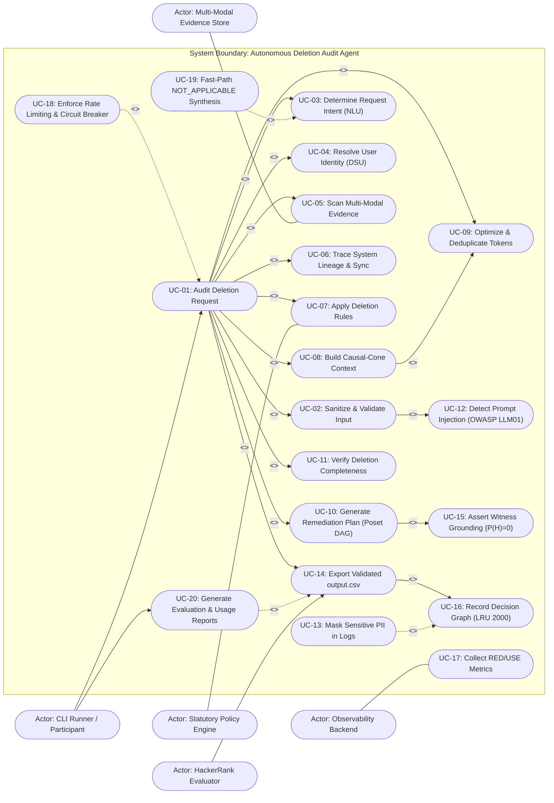

# UML Use Case Diagram: Autonomous Deletion Audit Agent
**Challenge:** HackerRank Orchestrate (October 2026) — *Ghost Data Still Exists*  
**System:** Enterprise Deletion Audit Agent & Compliance Verification Platform  
**Authors:** Visual Architecture & Design Squad (`uml-behavioral-diagram-engineer`, `technical-writer-agent`)  
**Specification Standards:** Conforms to UML 2.5.1 Section 18 (Use Cases) and Level 2.2 Docstrings-Only convention.

---

## 1. System Use Case Diagram

This diagram models the functional boundaries of the Deletion-Audit System, illustrating actor interactions, primary audit goals, extension guardrails, and inclusion dependencies.

---

## 2. Actor Specification & Goals

| Actor | Classification | Architectural Role & Goals |
|---|---|---|
| **CLI Runner / Participant** | Primary Human Actor | Triggers batch audit pipeline, configures worker threads, and inspects diagnostic logs. |
| **HackerRank Evaluator** | Primary Automated Actor | Ingests `output.csv`, grades prediction accuracy across 518 cases, and validates schema compliance. |
| **Evidence Store** | Secondary System Actor | Supplies multi-modal evidence artifacts (in-memory SQLite, JSON, logs, PDF, images). |
| **Policy Engine** | Secondary System Actor | Dictates required data treatment (`HARD_DELETE`, `RETAIN`, `REDACT`, `ANONYMIZE`, `ACCOUNT_TOMBSTONE`). |
| **Observability Backend** | Secondary System Actor | Ingests OpenTelemetry spans, Prometheus metrics, and structured JSON logs. |
